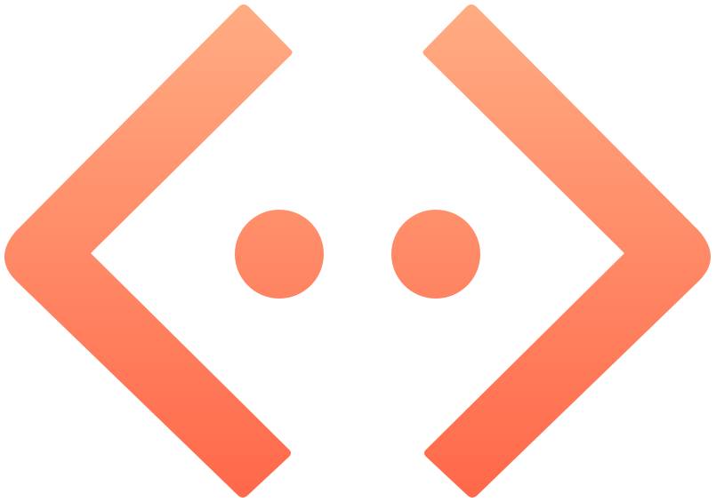
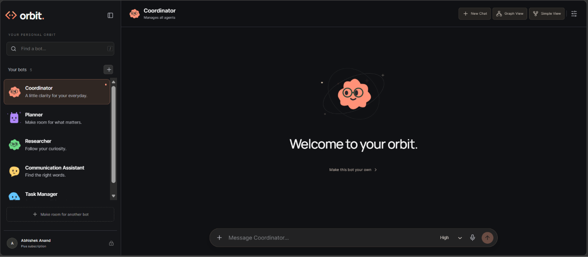
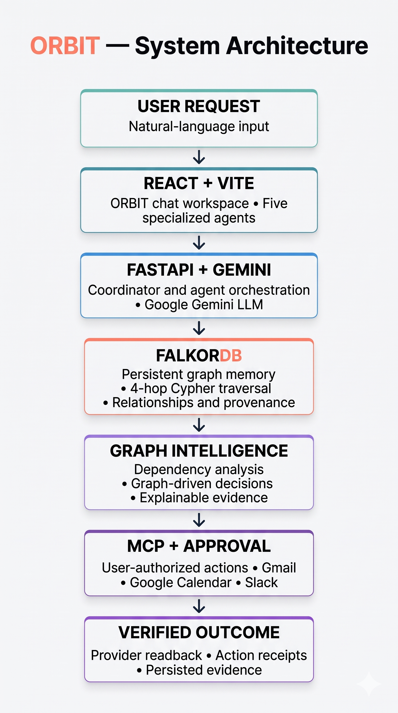
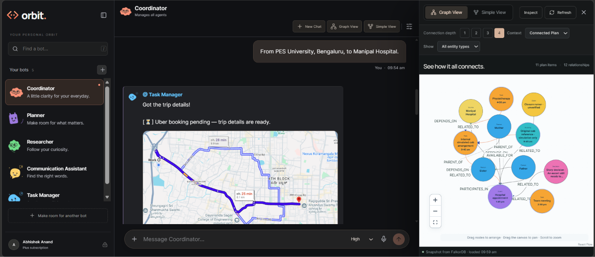
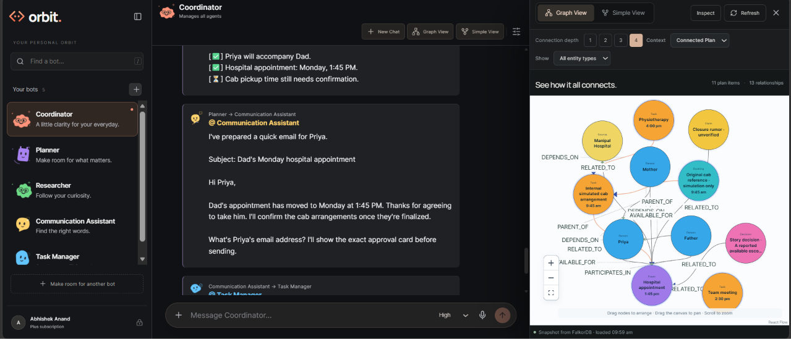
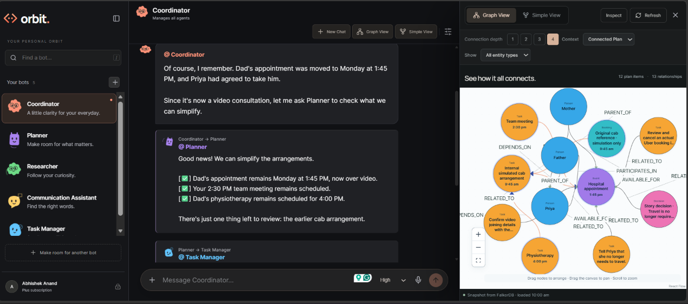

<div align="center">
  

  # ORBIT

  **One conversation. Five agents. A memory that understands connections.**

  *Graph Hacks 2026 · Track 01 — Agents That Act on Connected Data · Powered by FalkorDB*

  [**▶ Watch the Demo**](YOUR_VIDEO_LINK) · [**Live Demo**](YOUR_LIVE_DEMO_LINK) · [**Run Locally**](#run-orbit-locally)
</div>

---

## The idea

A hospital appointment moves from **11:00 AM to 1:45 PM**. Suddenly, the cab, family availability, a work meeting and physiotherapy may need attention. A conventional chatbot remembers the new time; **ORBIT follows the relationships to discover what else changes**.

ORBIT is a multi-agent workspace where conversations become a persistent **FalkorDB knowledge graph**. Specialized agents use shared context to plan, research, coordinate and propose actions—with evidence you can inspect.



## Built for connected decisions

| Capability | What ORBIT actually does |
|---|---|
| **Graph-native memory** | Remembers people, events, tasks, claims and decisions across conversations. |
| **Multi-hop reasoning** | Traverses up to four hops to identify affected dependencies and scheduling concerns. |
| **Five collaborating agents** | Coordinator, Planner, Researcher, Communication Assistant and Task Manager share graph context. |
| **MCP-powered tools** | Integrates Gmail, Google Calendar and Slack through scoped tool interfaces. |
| **Actions with accountability** | Proposes actions, requires approval for writes and records outcomes with verification evidence. |
| **Two graph views** | Explore the same stored relationships through an interactive network or a simplified flow. |

### Five agents, one connected context

| Agent | Role |
|---|---|
| **Coordinator** | Manages all agents and delegates work. |
| **Planner** | Plans actions and keeps notes on connected commitments. |
| **Researcher** | Finds information and checks source evidence. |
| **Communication Assistant** | Handles message drafts and replies. |
| **Task Manager** | Creates and tracks tasks. |

## The architecture



**React 19 + Vite** power the workspace; **FastAPI + Pydantic** handle orchestration and graph operations; **FalkorDB** stores connected memory and provenance. **React Flow + Dagre** render the graph. **Google Gemini** is integrated as the LLM for normal AI conversations and agent workflows, while **MCP** connects supported external services.

## FalkorDB does the reasoning—not just the visualization

ORBIT models typed entities such as `Person`, `Event`, `Task`, `Booking`, `Claim`, `Source`, `Decision`, `Action` and `Outcome`. Relationships including `DEPENDS_ON`, `ASSIGNED_TO`, `RELATED_TO`, `SUPPORTED_BY`, `SUPERSEDES` and `VERIFIED_BY` connect facts to dependencies, provenance and outcomes.

A representative bounded traversal from the graph repository:

```cypher
MATCH p=(a:Entity {id: $root})-[*1..4]-(b:Entity)
RETURN [n IN nodes(p) | properties(n)] AS nodes,
       [r IN relationships(p) | properties(r)] AS edges
LIMIT $limit
```

**The proof is counterfactual.** In ORBIT's hospital-rescheduling test, removing the appointment → cab dependency makes the cab warning disappear **even while the cab entity still exists**. Restoring the edge restores the warning. Removing other relevant edges changes the displayed consequences too.

That means the Planner's visible warnings are selected from **actual traversal paths**, not simply from prewritten mentions of existing entities.

[Graph queries](backend/orbit/repository.py) · [Graph-dependent Planner output](backend/orbit/story_words.py) · [Counterfactual tests](tests/orbit/test_part5_paths.py)

## See it in action

| Graph-based impact analysis | Multi-agent coordination |
|---|---|
|  |  |

**Cross-session memory:** A new chat recalls the earlier hospital plan, updates the appointment to video and produces a revised, persistent task checklist.



## From decision to verified action

ORBIT follows a controlled path: **graph evidence → agent proposal → user approval → MCP execution → provider readback → recorded outcome**. A draft or pending action is never treated as a verified external success.

[Agent orchestration](backend/orbit/agents.py) · [MCP tools](backend/orbit/mcp_tools.py) · [Action receipts](backend/orbit/receipts.py)

## Run ORBIT locally

**Requirements:** Python 3.10+, Node.js, npm, Docker Desktop and PowerShell (Windows).

```powershell
git clone https://github.com/Abhishekanand19/orbit-connected-agents.git
cd orbit-connected-agents

python -m venv .venv
.\.venv\Scripts\python.exe -m pip install -r backend/orbit/requirements.txt

cd frontend
npm ci
cd ..

.\start-demo.ps1
```

Open **http://127.0.0.1:5173**. Backend API docs: **http://127.0.0.1:8001/docs**. Docker must be running; `start-demo.ps1` starts FalkorDB and the local application using an isolated persistent demo graph.

**Optional environment configuration:** For normal Gemini conversations and real integrations, create a `.env` file at the repository root (never commit credentials):

```dotenv
GEMINI_API_KEY=your_gemini_api_key
GEMINI_MODEL=gemini-2.5-flash
GOOGLE_CLIENT_ID=your_google_oauth_client_id
GOOGLE_CLIENT_SECRET=your_google_oauth_client_secret
SLACK_BOT_TOKEN=your_slack_bot_token
```

Configure the Google OAuth redirect URI as `http://127.0.0.1:8001/auth/google/callback`. Request Google scopes through ORBIT's authorization flow; write operations require explicit approval. These credentials are **not required** for the deterministic family-demo workflow.

Test the graph-dependent decisions:

```powershell
.\.venv\Scripts\python.exe -m pytest tests/orbit/test_part5_paths.py -q
```

## Demo transparency

**Google Gemini** is ORBIT’s integrated LLM for normal AI conversations and agent workflows. The recorded seven-part walkthrough uses reproducible, templated dialogue; its memory updates, multi-hop traversal, graph-dependent decisions and evidence paths execute against **FalkorDB** without live Gemini calls during that walkthrough. Cab arrangements in the story are simulations, **not confirmed Uber bookings**; visual onboarding toggles do not establish real provider authorization.

**Built by [Abhishek Anand](https://github.com/Abhishekanand19) — solo submission.** AI coding assistants supported development, testing and documentation; project direction, integration decisions and final verification were developer-led.

---

<div align="center"><strong>ORBIT doesn't just remember what happened. It understands what that changes.</strong></div>
